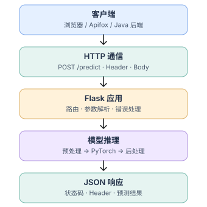

# HTTP、模型部署与交接笔记

HTTP 请求包含方法、URL、头和体；响应包含状态码、头和体。GET 一般读取资源，POST 在本任务中提交运算/推理输入。
JSON 是文本数据格式，Flask 的 `jsonify` 将 Python 字典序列化并设置 `application/json`。
`request.get_json()` 处理 JSON；`request.form` 读取表单文字字段；`request.files` 读取 multipart 文件。
JSON 中的数字和表单字符串需要统一校验。布尔值在 Python 是 int 子类，但本接口不允许把 true 当作 1。
NaN/Infinity 不属于标准 JSON 数值，输入与运算结果都应排除；除零和缺字段返回 400。

Content-Type 描述请求体格式，不能把 form-data 请求标为 application/json。multipart 的 boundary 由客户端生成。
X-API-Key 是本例的可选认证头；不要把上传文件名直接当作服务器存储路径。本实现直接从内存解码图片。
后端不信任扩展名，而是实际解码并检查像素规模。Flask 未捕获异常由统一错误处理转成 JSON，不把内部路径回传客户端。

WSGI 连接 Python 应用与同步 Web 服务器，Flask 可由 Waitress 承载。FastAPI 主要使用 ASGI，支持异步接口；
异步接口不会自动让 GPU 推理并行或变快，GPU 调度、批处理和多进程复制显存需要单独考虑。
Flask 自带服务适合调试，Waitress 是本任务提供的正式运行入口。监听 0.0.0.0 只是绑定网卡，不代表已配置云端公网访问。

图像模型链路：文件字节 → RGB 图 → 与训练一致的预处理 → NCHW 张量 → 指定设备 → eval/inference_mode → 后处理 → JSON。
分类器用预训练权重自带的 resize/crop/normalization；去雨网络使用 [0,1] RGB，不额外套用 ImageNet 输入归一化。
VGG 的 ImageNet 归一化仅用于训练损失编码器，不能直接当成去雨网络的输入预处理。
推理时 eval 关闭 dropout 等训练行为，inference_mode 关闭自动微分记录，二者作用不同。

交接给后端的契约：地址、POST 路径、字段大小写、请求头、文件大小限制、响应字段、错误码和模型 checkpoint 版本。
图片返回为 base64 会增加传输大小；小规模招新演示方便，正式服务可换成对象存储链接或二进制响应。

参考：[Flask 文件上传](https://flask.palletsprojects.com/en/stable/patterns/fileuploads/)、
[Flask 部署](https://flask.palletsprojects.com/en/stable/deploying/)、
[Waitress](https://docs.pylonsproject.org/projects/waitress/en/stable/)、
[PyTorch 安装](https://pytorch.org/get-started/locally/)。

代码已编写，尚未运行。Apifox 需要你在目标机器启动服务后自行联调并保存真实截图。
