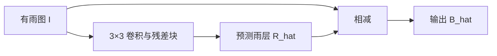

# 直接学习与残差学习

设有雨图像为 I，干净背景为 B，雨层为 R。简单加性模型是 I=B+R；网络可直接预测 B，
也可预测 R 后计算 B_hat=I-R_hat。本项目 baseline 与三尺度模型选后者。

图像大量背景不需改动时，学习差异可能更容易，输入的低频背景有直通路径；这并不保证残差方案总优于直接预测。
输出雨层是三通道连续值，不是简单二值雨丝掩码，也不能假设 RGB 都应非负，故最后一层不加 ReLU。
训练时不 clamp 输出，避免截断区域梯度；评价与保存时再裁到 [0,1]。
上游 U-Net 使用 final_conv(x)+input，等价于预测带符号的修正量；本项目损失实验保持其结构与加法不变。

雨丝和条纹的局部外观可能相似。模型只能从上下文、方向/尺度、背景纹理与训练样本中学习统计区别，
不具有天然判断“雨”的规则。多尺度、较大感受野与注意力可提供上下文，但也可能误删细线纹理。
严重遮挡时信息可能不可逆丢失，单张图像的恢复通常不唯一；模型可能生成合理细节，却不能保证还原真实背景。
合成雨分布与真实雨不同，Rain200L 上的效果不能直接代表真实场景能力。

状态：理论与代码已整理；未训练、未生成示意效果图。上述 Mermaid 为架构图。
