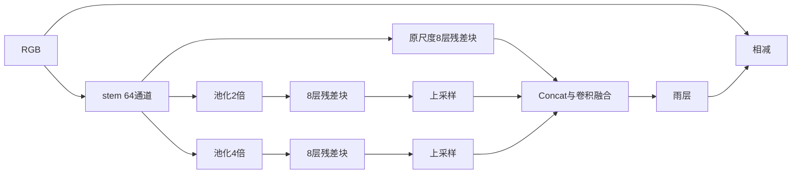

# 题目定义的 DeRainNet 三尺度结构

stem 把 RGB 投影到 64 通道；三个分支分别保持原尺度、MaxPool2d(2)、MaxPool2d(4)。
每分支有独立参数的八层 3×3 残差块，块输出为输入加卷积分支；双线性上采样到 stem 的精确 H/W，
沿通道 concat 得到 192 通道，再卷积融合并输出 RGB 雨层，最终从原图相减。

下采样让相同卷积核覆盖更大的原图范围，减少分支计算；上采样恢复空间尺寸，但不能凭空还原已经丢失的信息。
原尺度分支保留细节，融合后兼顾局部与上下文。Concat 沿通道堆叠特征而不是数值相加，需要空间尺寸一致。
该网络按招新题目的文字结构实现，不声称等价于某一同名论文。

实验规定使用 MSE、50 epochs，完整命令见 README。与 baseline 比较时使用相同数据划分、裁剪、batch、lr、seed 与精度，
同时指出训练轮数不同，不能把差异完全归因于结构。当前未训练，不报告提升幅度。
