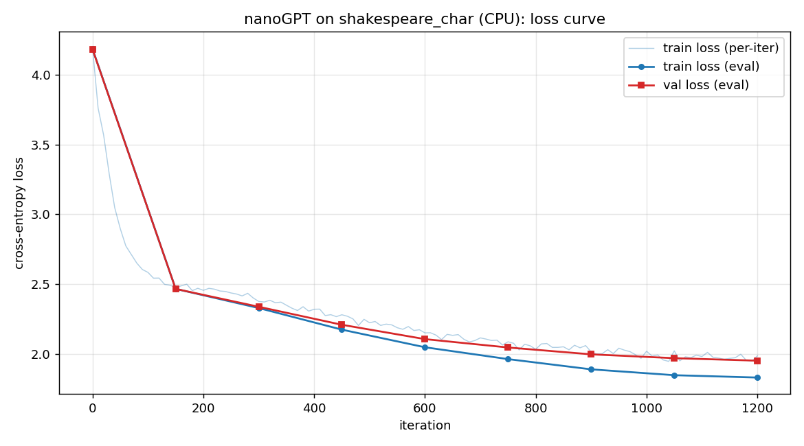

# Task 3：nanoGPT 部署、训练与文本生成实验报告

> 本报告记录在本地 CPU 环境上部署 nanoGPT、准备莎士比亚字符级数据、训练一个可收敛的小型 GPT，
> 并使用 checkpoint 完成文本生成的全过程。

---

## 1. 运行环境

| 项目 | 值 |
|---|---|
| 操作系统 | Windows 11 Home China (10.0.26200) |
| Python | 3.13.5 (Anaconda) |
| PyTorch | 2.14.0+cpu（**CPU 版，无 CUDA**） |
| numpy | 2.1.3 |
| matplotlib | 3.10.0 |
| tqdm | 4.67.1 |
| CPU | 13th Gen Intel Core i5-13420H（12 逻辑核，PyTorch 使用 8 线程） |
| GPU | 无 |

> 由于本机没有 GPU，训练全程在 CPU 上以 `float32` 进行，因此必须把模型规模缩小才能在合理时间内完成训练。

---

## 2. 部署结果（环境验证）

1. `git clone https://github.com/karpathy/nanoGPT.git` 成功，项目位于 `task_LLM/nanoGPT/`。
2. 依赖检查：`torch`、`numpy`、`tqdm` 均已安装；`sample.py` 顶部会 `import tiktoken`，
   本机未安装 tiktoken（且字符级数据并不需要它），因此我使用等价的自写脚本 `generate_demo.py` 完成生成。
3. 运行 `python data/shakespeare_char/prepare.py` 成功（见下节），证明项目可正常运行。

---

## 3. 数据准备结果

使用项目自带的 **Shakespeare character-level** 数据集（`data/shakespeare_char/`）。

**处理流程**（`prepare.py`）：

1. 下载/读取 `input.txt`：莎士比亚剧本原文，共 **1,115,394** 个字符。
2. **字符级 tokenization**：`chars = sorted(set(data))` 得到 65 个唯一字符，建立 `stoi`（字符→id）
   和 `itos`（id→字符）两个映射。**每个字符就是一个 token**，vocab_size = 65。
   词表为：` !$&',-.3:;?ABCDEFGHIJKLMNOPQRSTUVWXYZabcdefghijklmnopqrstuvwxyz`（含空格与换行）。
3. 划分 train/val：前 90% 作为训练集，后 10% 作为验证集。
   - `train.bin`：**1,003,854** 个 token id
   - `val.bin`：**111,540** 个 token id
4. 输出：
   - `train.bin` / `val.bin`：`uint16` 整数数组（token id 的二进制存储，供 `np.memmap` 高效读取）。
   - `meta.pkl`：保存 `vocab_size`、`stoi`、`itos`。

**模型实际接收的数据是什么？**

模型不直接读文本，而是读 `train.bin` 里的**整数 token id**。`train.py` 的 `get_batch` 每步随机取
`batch_size=64` 个起点，每个起点截取 `block_size=128` 个连续 id 作为输入 `x`（形状 `(64, 128)`），
标签 `y` 取自向后一个 token 起点的窗口（`data[i+1:i+1+block_size]`）。每个位置都预测紧随其后的字符，
最多依据 128 个字符的上下文。每个 micro-batch 的输入 token 数为 `64×128 = 8,192`。

---

## 4. 训练配置

我基于项目自带的 `config/train_shakespeare_char.py` 缩小出一个 CPU 可训练的配置
`config/train_shakespeare_char_cpu.py`：

| 超参数 | 值 | 含义 |
|---|---|---|
| `n_layer` | 4 | Transformer Block 层数 |
| `n_head` | 4 | 每个注意力层的头数 |
| `n_embd` | 128 | embedding / 隐藏层维度 |
| `block_size` | 128 | 上下文长度（最多看前 128 个字符） |
| `batch_size` | 64 | 每个 micro-batch 的样本数 |
| `gradient_accumulation_steps` | 1 | 不做梯度累积 |
| `learning_rate` | 1e-3 | 峰值学习率（warmup + cosine 衰减） |
| `max_iters` | 1200 | 总训练迭代数 |
| `lr_decay_iters` | 1200 | 学习率衰减总步数（= max_iters） |
| `min_lr` | 1e-4 | 衰减后的最小学习率 |
| `warmup_iters` | 100 | 线性 warmup 步数 |
| `dropout` | 0.2 | 防止小数据过拟合 |
| `weight_decay` | 1e-1（默认） | AdamW 权重衰减 |
| `device` | cpu | 训练设备 |
| `dtype` | float32 | 计算精度 |
| `eval_interval` | 150 | 每 150 步评估一次 train/val loss |
| `eval_iters` | 25 | 评估时平均的 batch 数 |
| `vocab_size` | 65 | 自动从 `meta.pkl` 读取 |

模型规模：**0.80M 参数**（811,136 个带权重衰减的参数 + 1,152 个不带权重衰减的参数）。

> 原版 `train_shakespeare_char.py` 是 `n_layer=6, n_head=6, n_embd=384`（10.65M 参数），
> 在本 CPU 上实测约 **33s/iter**，跑 5000 步需要约 46 小时，不可行；缩小后的配置实测约 **2.4s/iter**。

---

## 5. 训练结果

### 5.1 训练日志（loss 变化）

完整日志见 `task_LLM/train_log.txt`。评估点（每 150 步）的 loss 变化如下：

```
step    0: train loss 4.1832, val loss 4.1803
step  150: train loss 2.4664, val loss 2.4661
step  300: train loss 2.3291, val loss 2.3382
step  450: train loss 2.1745, val loss 2.2094
step  600: train loss 2.0484, val loss 2.1067
step  750: train loss 1.9636, val loss 2.0468
step  900: train loss 1.8904, val loss 1.9978
step 1050: train loss 1.8485, val loss 1.9704
step 1200: train loss 1.8317, val loss 1.9524   ← 最终（best val loss）
```

> 说明：初始 loss ≈ 4.18，接近 `ln(65) ≈ 4.17`，这是 65 类均匀预测的交叉熵参考值，
> **不是交叉熵下界**（理想预测损失可趋近 0）。该数值与近似均匀初始化一致，但不能单凭平均 loss 证明每个位置都均匀。
> 训练结束时 train loss 降到 1.83、val loss 降到 1.95，模型已经从"随机猜测"学到很强的字符规律。

### 5.2 loss 曲线

由 `plot_loss.py` 解析日志绘制的 `loss_curve.png`：



曲线中细线是每 10 步记录一次的 **train loss**（带噪声），圆点/方块是每 150 步评估一次
的 **train / val loss**。可以看到：

- 前 ~200 步 loss 下降最快，随后下降趋缓。它与逐步学习字符统计规律一致，但仅凭 loss 曲线不能确定具体学到了哪些依赖。
- eval 模式下的 train loss 通常略低于 val，所记录的 val 点持续下降，未观察到验证损失上升的过拟合迹象。
- 每步训练 loss 开启 dropout，eval loss 关闭 dropout 且平均多个窗口，两者不应直接等同。

### 5.3 训练耗时

- 单步（forward + backward）：约 **2.4 ~ 2.5 s**（日志中 `time` 字段）。
- 每次评估（eval_iters=25，train+val 共 50 个 batch 的前向）：约 **25 s**。
- 总耗时：历史日志无开始/结束墙钟时间，**约 55 分钟只是估算**，不是实测总时长；日志共有 9 个评估点。

---

## 6. 文本生成结果

加载 `out-shakespeare-char-cpu/ckpt.pt`（iter 1200，best val loss = 1.9524），
历史输出以 `temperature=0.8, top_k=200`、提示 `"\n"` 生成。完整输出见 `task_LLM/generate_output.txt`。
词表只有 65，top_k=200 会被截断为 65，因此没有实际限制采样候选。
历史生成脚本未在训练模型采样前固定 seed，不能保证复现旧文本；当前验证输出使用修正后的脚本并保存配置。

### 6.1 当前固定种子的训练后模型输出（节选）

```
COLUTES:
Thee pace on rolouns eare and
Thouge this por thou this tee; and a nothimser self;
That it coy mor ber somenglant:
Not of the nothe by sopor his now; they and the gelloan'ds
Marties prome I so hart thougs he hand my hear
```

以上文本直接节选自 `artifacts/verification/generation.json` 的第一个 trained 样本。
生成使用 seed=1337、temperature=0.8，每段新增 300 字符。可以观察到一些剧本文体特征：

1. **角色名 + 冒号** 的对白格式（`COLUTES:`），但人物名不一定真实；
2. **常见词和古英语词片段**：如 `Thee`、`this`、`self`、`they`；
3. **出现一些正确拼写的单词**，
   说明输出出现了常见词片段，但这里没有进行拼写正确率统计，不能据此量化语言能力；
4. **对白排版**：换行、标点和角色名结构开始出现，不能据此认定韵律正确。

局限仍很明显：如 `rolouns`、`nothimser` 等拼写异常，句子语义不连贯；不能将格式上的相似视为语言理解能力。

### 6.2 当前固定种子的随机模型输出（节选，对照组）

```
-pzlYaS ;czde.'wEyT,YVrzlGu-?YeNB
ijbo
Lzzj$eUUS-AAU FisVb'G HTssPPW;,Ue$zOAnsz-imszcAkfEaYYgS;RTNBE:myOzx.
```

以上节选自同一 JSON 的第一个 untrained 样本；字母、大小写、标点混杂，缺乏稳定的词和对白结构。
这是定性对照，没有额外计算文本质量指标。随机初始化与采样分别固定种子，模型架构与训练模型完全相同。
同一环境再次执行产生的 `generation_repeat.json` 与首次 JSON 完全一致。

---

## 7. 【进阶】实验分析

### 7.1 训练开始和结束时 loss 有什么变化？

- 训练开始：train/val loss ≈ 4.18（`ln(65)`），模型对每个字符输出近似均匀分布，即"纯随机猜测"。
- 训练结束：**train loss 1.83、val loss 1.95**，下降了约 2.3 nats。
- 下降节奏：前 ~200 步下降最快（4.18 → ~2.3），之后逐渐放缓（2.3 → 1.83）。
- 意义：loss 下降 = 模型逐渐学会字符序列的统计规律（空格分隔、字母频率、单词拼写、标点、换行结构等），
  从近似均匀预测逐步改善真实目标的平均负对数概率。
  交叉熵下降表示模型对实际目标的几何平均概率提高，并不等同于模型输出分布的熵下降。

### 7.2 生成文本相比未训练模型有什么变化？

- **未训练模型**：权重随机，输出的 logits 接近均匀分布，采样结果基本是**乱码**——
  随机字母、标点、空格无序混合，完全没有单词结构（见 6.2）。
- **训练后模型**：输出出现类似莎士比亚剧本的格式——部分正确拼写的英文单词、
  角色对话格式（`角色名:` 冒号对白，且名字全大写）、古英语词汇（thy/thou/hath/thee）、
  按行断句的诗歌排版（见 6.1）。尽管语义未必连贯、偶有假词，
  但在字符层面已经学到了语言和文体的统计规律。

这一对比说明：**语言模型"学会"的本质，就是从随机分布收敛到一个能刻画语料统计规律的分布，
而生成过程只是从这个学到的分布里采样。**

### 7.3 `n_layer`、`n_head`、`n_embd` 分别控制模型的什么属性？

- **`n_layer`（层数/深度）**：控制 Transformer Block 的堆叠数量，决定模型**深度**和表达能力上限。
  层数越多，能建模的抽象层次越深，但参数更多、训练更慢、更易过拟合/难优化。
- **`n_head`（头数）**：控制 Multi-Head Attention 分成几个并行的注意力子空间。
  它必须整除 `n_embd`（每个头的维度 = `n_embd / n_head`）。头越多，可并行关注的"关系类型"越多。
- **`n_embd`（嵌入维度）**：每个 token 的向量维度，决定模型的**宽度**。
  它同时是 Q/K/V 投影和 MLP 内部宽度的基准，直接决定每层参数量（大致与 `n_embd²` 成正比）。

三者的组合决定了模型总参数量（本实验 4/4/128 → 0.80M 参数；原版 6/6/384 → 10.65M 参数）。

### 7.4 `block_size` 表示什么？

`block_size` 是模型能看到的**最大上下文长度**（即序列长度 T）。
本实验 `block_size=128` 表示模型最多依据前 128 个字符预测下一个字符。
它决定了位置嵌入表 `wpe` 的行数，以及注意力矩阵的大小（`T×T`）。
Attention 的复杂度是 O(T²)，所以 block_size 越大，单步计算和显存/内存开销越大
（这也解释了为什么 block 256 比 128 慢一截）。

### 7.5 train loss 和 validation loss 分别反映什么？

- **train loss**：模型在**训练集**上的交叉熵，反映模型对**见过的数据**拟合得如何。
  训练过程中整体可能下降，但随机批次、dropout 和优化过程会产生波动，不保证单调下降。
- **val loss**：模型在**未见过的验证集**上的交叉熵，反映模型的**泛化能力**。
  它是判断模型好坏的更可靠指标。若 train loss 持续下降而 val loss 开始**回升**，
  说明开始过拟合（记住了训练集而没学会泛化）。
- 本实验在小数据上训练，`always_save_checkpoint=False` 让程序**只在 val loss 改善时保存 checkpoint**，
  正是用 val loss 作为模型选择的标准。

---

## 8. 复现步骤

在 `task_LLM/` 下运行 PowerShell。新实验输出与历史实验分离，生成和绘图都读取本轮训练产物：

```powershell
New-Item -ItemType Directory -Force artifacts/reproduction | Out-Null
cd nanoGPT
python data/shakespeare_char/prepare.py
python train.py config/train_shakespeare_char_cpu.py --out_dir=../artifacts/reproduction/model *> ../artifacts/reproduction/train.log
cd ..
python generate_demo.py --checkpoint artifacts/reproduction/model/ckpt.pt --output artifacts/reproduction/generation.json
python plot_loss.py --log artifacts/reproduction/train.log --csv artifacts/reproduction/loss.csv --output artifacts/reproduction/loss_curve.png
```

## 9. 2026-10-15 实际复核记录

本节为当前重新执行的验证；前面 1200 步训练和原生成文本是历史记录，未重新跑完整训练。

| 项目 | 当前证据 |
|---|---|
| 环境、源码 revision、checkpoint 配置 | `artifacts/verification/environment.json` |
| 总参数量（含位置嵌入，权重共享不重复计数） | 812,288 |
| 排除位置嵌入的参数量（上游打印口径） | 795,904，约 0.80M |
| checkpoint 迭代编号 | 1200 |
| 保存的 best validation loss | 1.9523751735687256，与日志四位小数 1.9524 一致 |
| 训练 / 验证 token 数 | 1,003,854 / 111,540 |
| 固定种子生成对照 | `artifacts/verification/generation.json`，每组 2 段、每段新增 300 字符 |
| 原日志重新解析 | `artifacts/verification/loss.csv`、`loss_curve.png` |
| 独立小模型短训练 | `artifacts/verification/smoke_train.log`、`smoke-model/ckpt.pt` |
| 新 checkpoint 加载生成 | `artifacts/verification/smoke_generation.json` |

短训练配置为 1 层、2 头、32 维、block_size=32、batch_size=2；验证损失在 step 0/2/4
分别为 4.1771/4.1377/4.1291。仅 4 步，不能证明收敛；该固定种子下训练和随机对照生成了相同文本，
说明短训练的采样变化很小。正式模型的新输出出现角色名、对白、常见词片段，但仍有大量拼写和语义问题。

验证测试覆盖：训练与推理 logits 形状、因果性、输入输出权重共享、上游 get_batch 的目标偏移、
checkpoint 编译前缀恢复、固定种子采样、非法参数与日志解析。

当前源码在 step 1200 评估并保存后，还执行 iter 1200 更新才退出，因此执行 0–1200 共 1201 次更新，
保存的 checkpoint 对应最后一次更新前的状态。历史“1200 步”描述应理解为配置值和 checkpoint 编号。

当前验证使用 4 个 torch 线程；历史报告中的 8 线程是历史记录，不是当前运行设置。
无法从原日志恢复总墙钟时间，也没有重新确认历史 CPU 型号，保留为历史信息。
